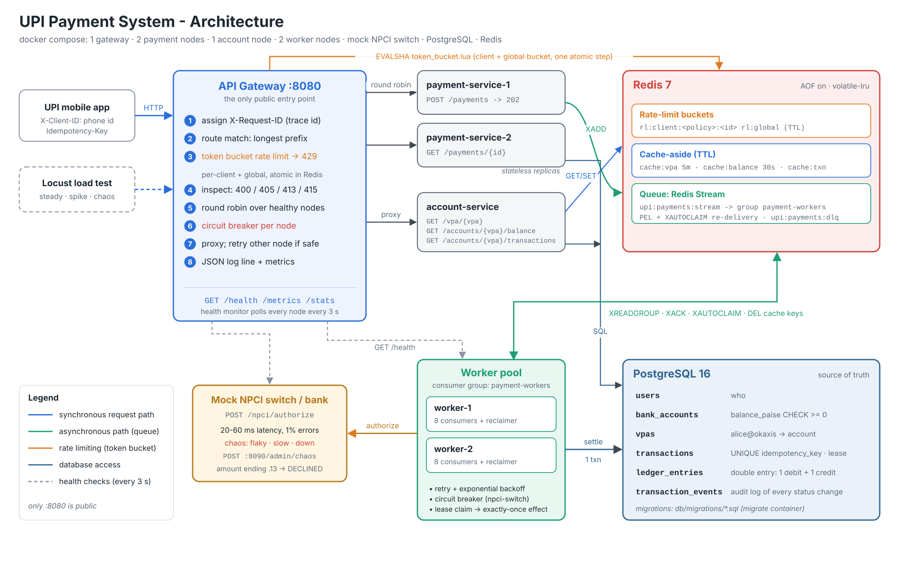

# UPI Payment System - Distributed System Design Project

A working, containerised model of the backend behind a UPI payments app (think GPay / PhonePe):
an **API gateway with token-bucket rate limiting**, stateless **payment** and **account** services,
**PostgreSQL** as the source of truth, **Redis** for caching, rate-limit state and the
**payment queue**, a pool of **asynchronous workers** that talk to a **mock NPCI switch**, and
**circuit breakers + retries with exponential backoff** for fault tolerance. Everything starts with
one `docker compose up`, and every request can be traced through every hop from the logs.

| Member | Name | Roll no. | GitHub |
|---|---|---|---|
| Member 1 | **Darsh Shah** | **26MCE001** | https://github.com/darsh-1010 |
| Member 2 | **Shrishti Karn** | **26MCE007** | https://github.com/shrishtikarn |




More detail: [data-flow diagram](docs/data-flow.png) · [design document](docs/DESIGN.md) ·
[database design](docs/DATABASE.md) · [10-minute demo script](docs/DEMO_SCRIPT.md)

---

## Assignment requirements -> where they are

| Phase | Requirement | Implementation |
|---|---|---|
| 1 | Architecture diagram + data-flow sketch | [`docs/architecture.png`](docs/architecture.png), [`docs/data-flow.png`](docs/data-flow.png) (generated by `docs/make_diagrams.py`), [`docs/DESIGN.md`](docs/DESIGN.md) |
| 1 | `docker compose up` spins up gateway + service nodes | [`docker-compose.yml`](docker-compose.yml) - 10 containers (+ optional Locust), one shared [`Dockerfile`](Dockerfile) |
| 1 | API gateway: inspect, route, **rate limit -> 429** | [`gateway/main.py`](gateway/main.py) (pipeline), [`gateway/ratelimit.py`](gateway/ratelimit.py) (token bucket, Redis Lua + local fallback) |
| 1 | Health endpoint reporting every node | `GET /health` on the gateway (polls each node's own `/health`), [`common/health.py`](common/health.py) |
| 2 | Database schema + migration scripts | [`db/migrations/`](db/migrations), runner [`db/migrate.py`](db/migrate.py), [`docs/DATABASE.md`](docs/DATABASE.md) |
| 2 | In-memory cache (Redis) | cache-aside in [`common/cache.py`](common/cache.py), used by [`account_service`](account_service/main.py) and [`payment_service`](payment_service/main.py); rate-limit counters also live in Redis |
| 2 | Async task queue + worker pool updating the DB | Redis Streams consumer group; [`worker/main.py`](worker/main.py), [`worker/processor.py`](worker/processor.py) |
| 2 | Compose file with DB, cache, workers | [`docker-compose.yml`](docker-compose.yml) (`postgres`, `redis`, `migrate`, `worker-1`, `worker-2`) |
| 3 | Resilience pattern(s) | **Circuit breaker** and **retry with exponential backoff + jitter** in [`common/resilience.py`](common/resilience.py); dead-letter queue, lease-based re-claim, sweeper |
| 3 | Load-testing script | [`loadtest/locustfile.py`](loadtest/locustfile.py) + orchestrator [`loadtest/run_loadtest.py`](loadtest/run_loadtest.py) |
| 3 | Metrics + structured logging to trace a request | [`common/logs.py`](common/logs.py) (JSON logs + request id), [`common/metrics.py`](common/metrics.py), `GET /stats`, `python scripts/demo.py trace <id>`, live dashboard at `/dashboard` |
| 3 | Load-test report | [`loadtest/make_report.py`](loadtest/make_report.py) generates `loadtest/results/LOAD_TEST_REPORT.md` (+ charts) from your own runs |
| 3 | Live demo | [`docs/DEMO_SCRIPT.md`](docs/DEMO_SCRIPT.md) + [`scripts/demo.py`](scripts/demo.py) |

---

## Quick start

**Prerequisites:** Docker Desktop (Windows / macOS) or Docker Engine with Compose v2, and Python 3.10+
on the host. Host-side scripts use only the Python standard library, so no `pip install` is needed.
(On Windows use `python`; on macOS/Linux `python3`.)

```bash
# 1. start everything (first build takes a few minutes)
docker compose up --build -d

# 2. check that every node is healthy
python scripts/demo.py health

# 3. run the end-to-end self test (11 checks)
python scripts/smoke_test.py
```

Then try it:

```bash
python scripts/demo.py pay alice@okaxis bob@oksbi 150        # send money and follow it to SUCCESS
python scripts/demo.py pay alice@okaxis bob@oksbi 150 --twice # same Idempotency-Key twice -> one debit
python scripts/demo.py balance bob@oksbi                     # X-Cache: MISS, then HIT
python scripts/demo.py burst --n 80                          # one client floods -> 429 Too Many Requests
python scripts/demo.py chaos down                            # break the bank; watch retries + circuit breaker
python scripts/demo.py chaos normal
python scripts/demo.py trace <request_id>                    # one request across all services
python scripts/demo.py stats                                 # metrics of every node on one screen
```

### Live dashboard

While the system is running, open **http://127.0.0.1:8080/dashboard** in a browser. It is served by
the gateway itself (no extra container) and updates every 2 seconds:

* **System health** - every node's status and circuit breaker, straight from `GET /health`.
* **How a request flows right now** - clients -> gateway -> services -> queue -> workers -> bank /
  PostgreSQL, with live rates; arrows turn red when a stage is failing.
* **Charts** - forwarded vs rejected (429) requests per second, queue depth, payments settled per second.
* **Latest transactions** - click one to see its journey: which node accepted it, which worker picked it
  up, retries, and how it ended (read from the `transaction_events` audit log).
* **Buttons** - send a payment, send the same payment twice (idempotency), a declined payment, flood one
  phone with 80 requests (rate limiter), simulated users, and switch the bank to flaky / slow / down.

The page lives in [`gateway/static/dashboard.html`](gateway/static/dashboard.html) (one file, no
external libraries, works offline). Its data comes from `/health`, `/stats` and `/dashboard/api/*`
(summary, latest transactions, one payment's audit trail, bank mode). Those are demo endpoints with
no authentication.

### Pay Console (person-to-person payments)

**http://127.0.0.1:8080/pay** is a separate interface where a person chooses **who pays, whom to pay and
how much**. It verifies the payee's registered name, sends the payment through the real public API
(rate limited like any phone), and shows the payment's 4-step journey (verify -> gateway 202 -> worker &
bank -> settled), the request id / node / rate-limit headers, **both balances before and after**, the
audit trail and the payer's history. One-click scenarios fill the form: P2P, pay a merchant, bank
decline, insufficient funds, over the Rs 1 lakh limit, pay yourself, unknown payee and double tap
(same Idempotency-Key twice). Source: [`gateway/static/pay.html`](gateway/static/pay.html).

Stop with `docker compose down` (add `-v` to wipe the database and Redis).

### Containers and ports

| Container | Role | Host port |
|---|---|---|
| `gateway` | API gateway, the **only public entry point** | **8080** |
| `payment-service-1`, `payment-service-2` | create payments, payment status (stateless replicas) | - |
| `account-service` | VPA lookup, balance, history (cache-heavy reads) | - |
| `worker-1`, `worker-2` | consume the payment queue, call the bank, settle in Postgres | - |
| `bank-mock` | mock NPCI switch with a chaos switch | 8090 (chaos API, demo only) |
| `postgres` | PostgreSQL 16, source of truth | 5432 (inspection) |
| `redis` | Redis 7: cache, rate-limit buckets, payment stream | 6379 (inspection) |
| `migrate` | one-shot: applies `db/migrations/*.sql`, then exits | - |
| `locust` | load generator (only with `--profile loadtest`) | 8089 |

Seed data: `alice@okaxis` and `bob@oksbi` (Rs 50,000 each), `chaipoint@okicici` (merchant, Rs 0),
and 1,000 load-test users `user0001@mockbank` ... `user1000@mockbank` (Rs 10,00,000 each).

---

## Public API (through the gateway, `http://localhost:8080`)

| Method & path | Purpose | Notes |
|---|---|---|
| `POST /api/v1/payments` | initiate a payment | requires `Idempotency-Key`; returns **202** + `txn_id` immediately |
| `GET /api/v1/payments/{txn_id}` | payment status | `PENDING -> PROCESSING -> SUCCESS / FAILED`; cached |
| `GET /api/v1/vpa/{vpa}` | verify payee name | cached 5 min |
| `GET /api/v1/accounts/{vpa}/balance` | balance | cached 30 s, invalidated after every payment |
| `GET /api/v1/accounts/{vpa}/transactions?limit=10` | history | first page cached 15 s |
| `GET /health` (`?live=true`) | gateway + per-node health | 200 `UP`/`DEGRADED`, 503 `DOWN` |
| `GET /metrics`, `/metrics/prometheus` | gateway metrics | JSON or Prometheus text |
| `GET /stats` | metrics of **every** node in one document | used by the load-test tooling |
| `GET /dashboard` | live dashboard (HTML) | polls `/health`, `/stats`, `/dashboard/api/*` |

Headers the gateway understands / adds:

* `X-Client-ID` (request): device id used for per-client rate limiting (falls back to client IP).
* `X-Request-ID` (request/response): trace id; generated if absent and propagated everywhere.
* `X-RateLimit-Limit`, `X-RateLimit-Remaining`, `X-RateLimit-Policy`, `Retry-After` (on 429).
* `X-Upstream-Node`, `X-Gateway-Latency-Ms`, `X-Cache` (from the services).

```bash
curl -s -X POST http://localhost:8080/api/v1/payments \
  -H "Content-Type: application/json" -H "X-Client-ID: my-phone" \
  -H "Idempotency-Key: $(uuidgen)" \
  -d '{"payer_vpa":"alice@okaxis","payee_vpa":"bob@oksbi","amount":"150.00","note":"chai"}'
```

PowerShell:

```powershell
$headers = @{ "X-Client-ID" = "my-phone"; "Idempotency-Key" = [guid]::NewGuid().ToString() }
$body = @{ payer_vpa = "alice@okaxis"; payee_vpa = "bob@oksbi"; amount = "150.00" } | ConvertTo-Json
Invoke-RestMethod -Method Post -Uri http://localhost:8080/api/v1/payments -Headers $headers -ContentType "application/json" -Body $body
```

Error bodies always look like `{"error": "RATE_LIMITED", "message": "...", "request_id": "..."}`.
Demo trick: any amount ending in **.13** (for example `1.13`) is declined by the mock bank.

---

## How it works (short version; details in [DESIGN.md](docs/DESIGN.md))

**Gateway pipeline:** request id -> route match -> **rate limit** -> inspection (method 405, body size
413, content type 415, missing `Idempotency-Key` 400) -> pick a healthy node (round robin, skipping
nodes that are `DOWN` or whose **circuit breaker** is open) -> proxy -> retry once on another node
when that is safe (GETs, or POSTs with an idempotency key) -> JSON log line + metrics.

**Rate limiting - token bucket, two levels, atomic in Redis.** Every request must take a token from
its client's bucket (`read`: burst 40, 20/s; `write`: burst 10, 2/s) **and** from a global bucket
(burst 500, 300/s) that protects the backend as a whole. A Lua script checks and updates both
buckets in one atomic step using Redis' own clock, so several gateway replicas share one consistent
limit. If Redis is unreachable the gateway falls back to an in-process bucket instead of failing.

**Caching - cache-aside with TTLs and explicit invalidation.** Reads try Redis first, fall back to
Postgres on a miss, then populate the cache. The worker deletes affected keys (balances, history,
status) the moment a payment completes. If Redis is down, services read straight from Postgres.

**Asynchronous processing - Redis Streams consumer group.** `POST /payments` stores the payment as
`PENDING` (idempotently) and `XADD`s a message; it answers **202** in milliseconds. Workers
`XREADGROUP`, claim the transaction with a lease, call the bank switch, then move the money in **one
Postgres transaction** (row locks in fixed order -> debit -> credit -> 2 ledger entries -> `SUCCESS`
-> audit event), `XACK`, and invalidate the cache.

**Fault tolerance.**

| Failure | What happens |
|---|---|
| Bank slow / erroring | retries with exponential backoff (0.2 s, 0.4 s, 0.8 s, equal jitter) |
| Bank down | after 5 consecutive failures the **circuit breaker opens**: no calls for 10 s, then one trial call |
| Still failing | payment goes back to `PENDING`, message **not ACKed**, re-delivered by `XAUTOCLAIM` after 15 s; after 3 attempts -> `FAILED` + dead-letter stream |
| Worker crashes mid-payment | message stays in the pending list, lease expires, another worker re-claims it |
| Payment node down | gateway health checks + per-node breaker route traffic to the other node |
| Duplicate request / message | `Idempotency-Key` (DB unique index) + lease claim -> money moves at most once |
| Redis down | rate limiter -> local buckets; cache -> bypass; publish failure -> sweeper re-enqueues |
| Traffic spike | global token bucket sheds excess load with cheap 429s; queue absorbs payment bursts |

**Observability.** Every service logs one JSON object per line with `service`, `node`, `event` and
`request_id`. The id is created at the gateway, forwarded as a header, copied into the queue message
and stored on the transaction row, so `python scripts/demo.py trace <request_id>` reconstructs the
path Gateway -> Cache -> Queue -> Worker -> Bank -> Database. Every node exposes counters, gauges and
latency histograms on `/metrics`; the gateway aggregates them at `/stats`.

---

## Load testing and the report

```bash
python loadtest/run_loadtest.py --preset all     # 5 scenarios, about 12 minutes
python loadtest/make_report.py                    # writes loadtest/results/LOAD_TEST_REPORT.md
```

| Preset | What it shows |
|---|---|
| `baseline` | 100 steady users for 60 s: normal throughput and latency |
| `spike` | 60 -> **600** -> 60 users: the global bucket sheds load, the queue absorbs payments |
| `spike-no-limiter` | same spike with `RATE_LIMIT_ENABLED=false`: what happens without protection |
| `spike-no-cache` | same spike with `CACHE_ENABLED=false`: database load without the cache |
| `chaos` | 80 users while the bank goes `flaky` (t=20 s) -> `down` (t=40 s) -> `normal` (t=60 s) |

Each run saves Locust CSV/HTML plus before/after snapshots of `/stats`. The report then shows
throughput, latency (client-side and gateway-side), 429s per bucket, cache hit ratio, DB queries,
payment outcomes, queue depth over time and circuit-breaker activity, with charts if `matplotlib` is
installed (`pip install matplotlib`). Every number in the report comes from your own runs.

### Scalability test: 100 / 200 / 500 users and the bottleneck

```bash
python loadtest/scale_test.py --gateway-workers 4   # 100, 200, 500 users, 500 without limiter, 500 with 4 gateway processes (~12 min)
python loadtest/scale_report.py                     # loadtest/results/scale/summary.json + charts
```

Measured on one 12-thread laptop (all containers + Locust sharing it):

| Run | req/s | p50 | p95 | Gateway CPU |
|---|---|---|---|---|
| 100 users | 138 | 11 ms | 270 ms | 83 % |
| 200 users | 86 | 640 ms | 4.6 s | 113 % |
| 500 users | 66 | 2.7 s | 19 s | 113 % |
| 500 users, 4 gateway processes (`GATEWAY_WORKERS=4`) | 157 | 1.3 s | 6.0 s | 294 % |

**Bottleneck: the single-process API gateway.** It saturates one CPU core, so throughput *falls* as users
grow, while the services (account p95 ~7 ms), PostgreSQL (p95 ~5 ms) and the workers (payment end-to-end
~67 ms) stay fast. Running 4 gateway processes gave 2.4x the throughput; the next hot spots are then
PostgreSQL and the single account-service replica. Details: section 5 of the
[project report](submission/26MCE001_26MCE007_UPI_Project_Report.pdf).

### Functional test with 100+ users

```bash
python scripts/multi_user_test.py              # 228 distinct users, 17 scenario types, ~75 s
python scripts/capture_report_assets.py        # same test + screenshots of dashboard, Pay Console and logs
python scripts/capture_submission_screens.py   # CLI / DB / Redis / tests / Locust screens
python scripts/build_submission.py             # submission/*.pdf
```

The test checks every outcome (P2P, P2M, concurrent payments to one payee, concurrent overspend,
double tap, key reuse, declines, invalid requests, rate limit, bank flaky / down) and then verifies that
the total money is unchanged and every account moved by exactly its successful payments.

For the **live demo** use the Locust web UI instead:
`docker compose --profile loadtest up -d locust`, then open http://localhost:8089 (host
`http://gateway:8080`). Set `LOAD_SHAPE=spike` before that command for the spike shape.

Results depend on the machine running Docker. On a laptop all containers share the same
CPU cores, so treat absolute numbers as relative comparisons between scenarios.

---

## Configuration

All settings are environment variables (defaults in `docker-compose.yml`). Override them when
starting, for example `RL_GLOBAL_REFILL_PER_S=100 docker compose up -d gateway` (PowerShell:
`$env:RL_GLOBAL_REFILL_PER_S=100; docker compose up -d gateway`).

| Variable | Default | Effect |
|---|---|---|
| `RATE_LIMIT_ENABLED` | `true` | turn the gateway limiter off (for comparison runs) |
| `RL_READ_CAPACITY` / `RL_READ_REFILL_PER_S` | 40 / 20 | per-client bucket for GETs |
| `RL_WRITE_CAPACITY` / `RL_WRITE_REFILL_PER_S` | 10 / 2 | per-client bucket for payments |
| `RL_GLOBAL_CAPACITY` / `RL_GLOBAL_REFILL_PER_S` | 500 / 300 | whole-system bucket |
| `CACHE_ENABLED` | `true` | turn caching off in payment/account services |
| `WORKER_CONCURRENCY` | 8 | consumer tasks per worker container |
| `BANK_MODE` | `normal` | start the bank mock in `flaky` / `slow` / `down` |
| `LOG_LEVEL` | `INFO` | `DEBUG` also logs every cache hit/miss |

Worker resilience knobs (`BANK_TIMEOUT_S`, `BANK_RETRIES`, `BACKOFF_BASE_S`, `CB_FAILURE_THRESHOLD`,
`CB_RESET_TIMEOUT_S`, `MAX_DELIVERY_ATTEMPTS`, `RECLAIM_IDLE_MS`) are listed in the `worker-1` block.

---

## Project structure

```
gateway/            API gateway: pipeline, token bucket, routing/load balancing, health monitor, live dashboard (static/)
payment_service/    POST /payments (idempotent insert + enqueue), GET /payments/{id}
account_service/    VPA lookup, balance, history - cache-aside reads
worker/             queue consumers, reclaimer, sweeper; bank client; settlement logic
bank_mock/          mock NPCI switch with chaos modes
common/             logging, metrics, health, cache, circuit breaker, retry, shared SQL/keys
db/                 migrations/*.sql + migration runner
loadtest/           locustfile, run_loadtest.py (orchestrator), make_report.py, results/
scripts/            demo.py (demo + ops CLI), smoke_test.py, multi_user_test.py, screenshot + report builders
reports/            multi-user test results and screenshots
submission/         demonstration PDF, project report PDF, presentation (file names carry the roll numbers)
tests/              unit + behaviour tests (pytest)
docs/               diagrams, DESIGN.md, DATABASE.md, DEMO_SCRIPT.md
.github/workflows/  CI: unit tests, then docker compose up + smoke test + short load test
```

## Tests

```bash
pip install -r requirements.txt pytest
pytest                       # token bucket, circuit breaker, retry, metrics, gateway proxy, worker logic
docker compose up -d redis && pytest tests/test_lua_token_bucket_redis.py   # Lua script on real Redis
python scripts/smoke_test.py # end-to-end against the running stack
```

The GitHub Actions workflow runs all of this, plus a short load test, on every push.

## Team responsibilities (proposed split for the demo - edit to match who did what)


| Shrishti Karn (26MCE007) | `db/`, `payment_service/`, `account_service/`, `worker/`, `common/cache.py`, `loadtest/`, `scripts/`, `common/logs.py`, `common/metrics.py` | phase 2: schema, idempotency, cache-aside, queue + worker; phase 3: load test, tracing, report  `gateway/` (pipeline, token bucket, health, dashboard, Pay Console), `docker-compose.yml`, diagrams, `common/resilience.py` | phase 1: routing, rate limiter, health checks; phase 3: circuit breaker + retries  |

## Simplifications compared with real UPI

Real UPI has the payer's PSP app -> PSP backend -> **NPCI** -> remitter bank (debit) and beneficiary
bank (credit), with the UPI PIN encrypted on the phone and verified by the issuer bank. Here a
single mock service stands in for NPCI and both banks, balances live in our own Postgres, and there
is no UPI PIN, authentication or TLS. The structure of the problem is the same, which is what this
project is about: a slow, unreliable external dependency, money that must move exactly once, and
bursty traffic.

## Troubleshooting

* **Gateway says `DOWN` right after start-up** - services wait for `migrate`; give it ~20 s, or run
  `docker compose ps` / `docker compose logs migrate`.
* **Port already in use** - change the left side of `ports:` in `docker-compose.yml` (e.g. `"8081:8080"`).
* **Windows: `python` opens the Microsoft Store** - install Python from python.org and tick "Add to PATH".
* **Windows: requests are slow / the burst shows no 429s** - use `http://127.0.0.1:8080`, not
  `http://localhost:8080`. On Windows "localhost" tries IPv6 first, which can add 1-2 s per request with
  Docker Desktop, so a "burst" trickles in slower than the bucket refills. The scripts default to 127.0.0.1.
* **Start from scratch** - `docker compose down -v && docker compose up --build -d`.
* **Locust results folder not writable (Linux)** - the locust container runs as root to write into
  `./loadtest/results`; `sudo chown -R $USER loadtest/results` afterwards if needed.
