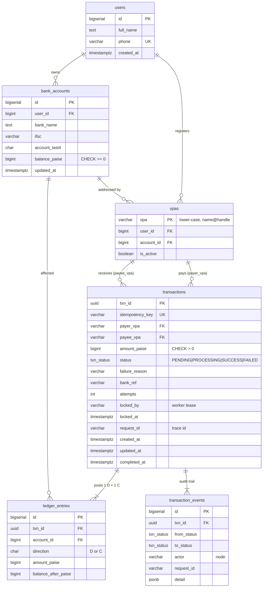
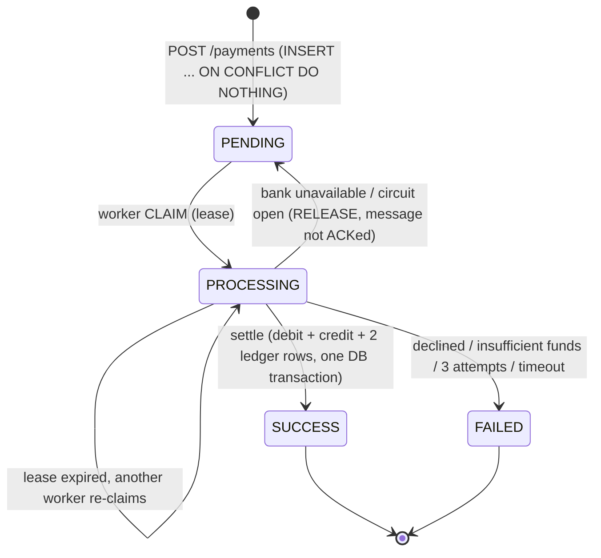

# Database design (PostgreSQL 16)

Migrations live in [`db/migrations`](../db/migrations) and are applied in order by
[`db/migrate.py`](../db/migrate.py), which runs as the one-shot `migrate` container before any
service starts. Applied files are recorded in `schema_migrations`; each file runs in its own
transaction, and a Postgres advisory lock stops two runners migrating at once.

| File | Contents |
|---|---|
| `001_init_schema.sql` | tables, enum, constraints, indexes |
| `002_seed_demo_data.sql` | 3 demo users + 1,000 load-test users (development data) |
| `003_dashboard_recent_index.sql` | index on `transactions(created_at DESC)` for the dashboard's "latest transactions" |

Add a change as `003_<description>.sql`; never edit an applied file.

## Entity-relationship diagram



## Status machine



Every transition is a conditional `UPDATE ... WHERE status IN (...)`, so a stale or duplicate
worker can never move a final transaction again (`SUCCESS`/`FAILED` rows match no update).

## Constraints that protect money

| Constraint | Protects against |
|---|---|
| `bank_accounts.balance_paise CHECK (>= 0)` | overdraft, even if application logic were wrong |
| `transactions.idempotency_key UNIQUE` | double payment on client retry |
| `transactions CHECK (payer_vpa <> payee_vpa)` | paying yourself |
| `transactions.amount_paise CHECK (> 0)` | zero/negative transfers |
| `ledger_entries UNIQUE (txn_id, direction)` | posting a transaction twice |
| foreign keys on every reference | orphan VPAs, transactions, ledger rows |

## Indexes and why

| Index | Serves |
|---|---|
| `transactions (payer_vpa, created_at DESC)` and `(payee_vpa, created_at DESC)` | history query: two index range scans merged with `UNION ALL` |
| `transactions (updated_at) WHERE status IN ('PENDING','PROCESSING')` | sweeper; partial index stays tiny because almost all rows are final |
| `transactions (idempotency_key)` (unique) | idempotent insert / replay lookup |
| `ledger_entries (account_id, created_at DESC)` | account statement |
| `transaction_events (txn_id, id)` | audit trail of one payment |
| `vpas (account_id)`, `bank_accounts (user_id)` | joins |

## Handy queries for the demo

```bash
docker compose exec postgres psql -U upi -d upi
```

```sql
-- latest payments
SELECT txn_id, payer_vpa, payee_vpa, amount_paise/100.0 AS rupees, status, failure_reason, attempts, request_id
FROM transactions ORDER BY created_at DESC LIMIT 10;

-- the audit trail of one payment
SELECT from_status, to_status, actor, detail, created_at FROM transaction_events
WHERE txn_id = '<txn_id>' ORDER BY id;

-- double-entry check: every successful payment has exactly one debit and one credit of the same amount
SELECT t.status, count(*) FILTER (WHERE l.direction='D') AS debits, count(*) FILTER (WHERE l.direction='C') AS credits
FROM transactions t LEFT JOIN ledger_entries l USING (txn_id) GROUP BY t.status;

-- money is conserved: this total never changes, whatever the load test did
SELECT sum(balance_paise) FROM bank_accounts;

-- status breakdown after a load test
SELECT status, failure_reason, count(*) FROM transactions GROUP BY 1, 2 ORDER BY 3 DESC;
```
