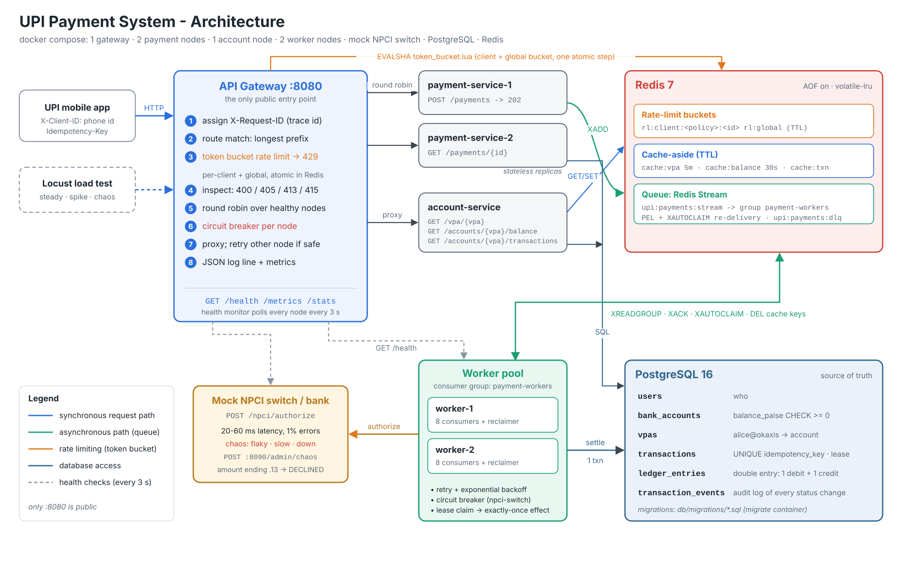

# Design document - UPI Payment System

## 1. Scope

**Functional:** verify a payee's VPA, check balance, send money, follow a payment's status, view
recent transactions.

**Non-functional goals:**

| Goal | How it is met |
|---|---|
| Accept a payment fast even though the bank is slow | request path only writes `PENDING` + enqueues; the bank call happens in a worker |
| Never move money twice | `Idempotency-Key` unique index, lease-based claim, conditional status updates, one DB transaction for settlement |
| Survive a misbehaving client or a traffic spike | per-client + global token buckets at the gateway (429 + `Retry-After`) |
| Survive a failing dependency | retries with exponential backoff, circuit breaker, delayed re-delivery, dead-letter queue |
| Keep the database out of the hot read path | cache-aside in Redis with TTLs and explicit invalidation |
| Explain any request after the fact | request id propagated end to end, JSON logs, per-node metrics |
| Scale horizontally | stateless services and gateway; workers join one consumer group |

## 2. Components

| Component | Responsibility | State |
|---|---|---|
| API gateway | single entry point; rate limiting, inspection, routing, load balancing, health monitoring | none (buckets live in Redis) |
| payment-service x2 | validate + idempotently create payments, enqueue, serve status | none |
| account-service | VPA lookup, balance, history (read-heavy) | none |
| worker x2 | consume queue, call bank switch, settle money, invalidate cache | none (PEL in Redis) |
| bank-mock | stands in for NPCI + issuer banks; injectable latency/failures | chaos settings only |
| PostgreSQL | source of truth: users, accounts, VPAs, transactions, ledger, audit events | durable |
| Redis | rate-limit buckets, cache, payment stream + consumer group, DLQ | AOF persistence |

## 3. Life of a payment

See [data-flow.png](data-flow.png). Short version:

1. App -> gateway `POST /api/v1/payments` with `Idempotency-Key` and `X-Client-ID`.
2. Gateway takes one token from the client's *write* bucket and from the global bucket (one Lua call).
3. Gateway validates the request, picks a healthy payment node (round robin) and forwards it with `X-Request-ID`.
4. Payment service validates the body, resolves both VPAs (cache-aside), then
   `INSERT ... ON CONFLICT (idempotency_key) DO NOTHING RETURNING ...` as `PENDING` plus an audit event,
   then `XADD upi:payments:stream {txn_id, request_id}` and returns **202**.
5. A worker receives the message via `XREADGROUP`, claims the transaction (`PENDING -> PROCESSING`
   with a lease), checks the balance, calls the bank switch under retry + circuit breaker.
6. On approval it settles in one database transaction, `XACK`s the message and deletes the affected cache keys.
7. The app polls `GET /payments/{id}`; status is cached briefly while pending and for 5 minutes once final.

## 4. API gateway

### 4.1 Pipeline
`request id -> route -> rate limit -> inspect -> choose node -> proxy (+ safe retry) -> log/metrics`.
Rate limiting runs **before** inspection and body parsing so a flood costs as little as possible.

### 4.2 Why a token bucket?

| Algorithm | Bursts | Memory | Boundary problem | Verdict |
|---|---|---|---|---|
| Fixed window counter | allowed at window edges (2x limit in 1 s) | 1 counter | yes | too coarse |
| Sliding log | exact | one entry per request | no | memory heavy |
| Leaky bucket (queue) | smoothed, requests wait | queue | no | adds latency; we would rather reject |
| **Token bucket** | **bounded burst (capacity), sustained rate (refill)** | **2 numbers** | **no** | chosen |

Real users are bursty (open app -> balance -> verify payee -> pay), so a bucket that allows a short
burst but enforces an average rate fits well. State per bucket is just `(tokens, last_ts)`; refill
is computed lazily: `tokens = min(capacity, tokens + elapsed * rate)`.

### 4.3 Two levels of buckets
* **Per client** (`read` 40 burst / 20 per s, `write` 10 burst / 2 per s): fairness. One buggy app
  in a retry loop cannot starve everybody else.
* **Global** (500 burst / 300 per s): protects the backend's capacity. During a spike the gateway
  answers excess requests with a 429 in about 1 ms instead of letting every request queue up and
  time out. The global limit should be set just below the measured capacity of the system
  (use the `spike-no-limiter` run to find it).

Both buckets are checked in **one** Lua script: a token is taken from both only if both have one,
so a request rejected by the global bucket does not burn the client's token.

### 4.4 Atomicity and multiple gateways
A read-modify-write from Python (`HGET`, compute, `HSET`) would let two concurrent requests both
take the last token. Redis executes a Lua script atomically, which removes the race without locks.
The script reads the time with `TIME` inside Redis, so gateway replicas with skewed clocks still
agree. Keys carry a TTL of `capacity/rate + 5 s`; an idle bucket is equivalent to a full one, so
expiring it loses nothing.

**If Redis is unavailable** the limiter switches to an in-process bucket with the same semantics for
5 s, then tries Redis again. Limits become per gateway replica, which is weaker but far better than
either rejecting everything (fail closed) or accepting everything (fail open).

### 4.5 Load balancing, health and per-node breakers
* A background monitor polls each node's `GET /health` every 3 s. A node reports `DOWN` (503) when
  a **critical** dependency fails (Postgres) and `DEGRADED` when a non-critical one fails (Redis for
  the API services, which can fall back).
* Each upstream node also has a **circuit breaker** fed by real traffic (connection errors,
  timeouts, 5xx). It reacts within 5 failed requests instead of waiting for the next poll.
* Round robin skips nodes that are `DOWN` or whose breaker is open.
* **Retry on another node only when safe:** GETs, or POSTs that carry an `Idempotency-Key`
  (repeating them cannot charge twice).

## 5. Data model and consistency

Full schema: [DATABASE.md](DATABASE.md). Key decisions:

* **Money in integer paise** (`BIGINT`), never floats.
* `CHECK (balance_paise >= 0)` as the last line of defence against overdraft.
* **Idempotency:** `transactions.idempotency_key UNIQUE`. The insert uses `ON CONFLICT DO NOTHING
  RETURNING`; a replay gets the original transaction back (HTTP 200, `Idempotent-Replay: true`), and
  re-using a key for a *different* payment returns 409.
* **Lease-based claim:** `UPDATE ... SET status='PROCESSING', locked_by=$node, locked_at=now()
  WHERE txn_id=$1 AND (status='PENDING' OR lease expired) RETURNING ...`. Only one worker can win;
  duplicate queue messages become no-ops.
* **Settlement** in one transaction: lock the transaction row, lock both account rows **ordered by
  id** (prevents A->B / B->A deadlocks; verified with 16 concurrent clients doing opposite transfers),
  re-check the balance under the lock, debit, credit, write a debit and a credit **ledger entry**
  (`UNIQUE (txn_id, direction)`), set `SUCCESS`, write an audit event.
* `transaction_events` is an append-only audit log of every status change, with actor (node) and
  request id: the "transaction log" the assignment asks for.

## 6. Caching

| Key | Content | TTL | Invalidated by |
|---|---|---|---|
| `cache:vpa:<vpa>` | registered name, bank, active | 5 min | (static data) |
| `cache:balance:<vpa>` | balance | 30 s | worker after each successful payment of either party |
| `cache:history:<vpa>` | latest 10 transactions | 15 s | worker after each payment of either party |
| `cache:txn:<id>` | payment status | 1 s while pending, 5 min when final | worker on completion |

* **Pattern:** cache-aside (lazy loading). Simple, and the cache only holds data that is actually read.
* **Consistency:** invalidate-on-write keeps the common case fresh; the TTL bounds staleness if an
  invalidation is lost (e.g. Redis blip). A balance shown in an app may be up to 30 s old in that
  worst case. That is acceptable for display, and the authoritative check happens in the worker
  under a row lock, never against the cache.
* **Degradation:** every Redis error is treated as a miss, so the services keep working on Postgres alone.
* **Memory policy:** `maxmemory 256mb`, `volatile-lru`: under pressure Redis evicts only keys with
  a TTL (cache entries, rate-limit buckets), **never the payment stream**.
* Not implemented (discussion points): request coalescing / "single flight" against cache stampedes,
  probabilistic early refresh.

## 7. Asynchronous processing

**Why:** the bank round trip is slow and unreliable (tens of ms normally, seconds or errors when
things go wrong). Doing it inside the HTTP request would tie up connections and make users wait. The
request path therefore does only a few milliseconds of local work and returns 202.

**Why Redis Streams** (instead of RabbitMQ/Kafka): Redis is already in the stack; streams provide
consumer groups (load balancing across workers), acknowledgements, a Pending Entries List (PEL) for
un-acked messages, `XAUTOCLAIM` for taking over stuck messages, and persistence with AOF. For larger
scale Kafka (partitioned log, replay) or RabbitMQ (rich routing, per-message TTL and DLX) would be
the next step.

**Delivery semantics:** at-least-once delivery + idempotent consumer (lease claim + conditional
updates) = effectively exactly-once *effect* on balances.

| Mechanism | Purpose |
|---|---|
| consumer group `payment-workers` | each message goes to one worker; add workers to scale |
| no `XACK` on transient failure | message stays in the PEL |
| reclaimer: `XAUTOCLAIM` idle > 15 s | delayed retry, plus recovery from crashed workers |
| `MAX_DELIVERY_ATTEMPTS = 3` | bound retries, then `FAILED` + copy to `upi:payments:dlq` |
| `TXN_TIMEOUT_S = 120` | too-old payments end as `FAILED: TIMEOUT` (like UPI's deemed status) |
| sweeper (every 30 s, one worker via `SET NX` lock) | re-enqueues `PENDING` payments older than 60 s whose message was never published (the DB-write-then-XADD **dual-write** problem; a transactional outbox table would be the stricter fix) |
| `XADD MAXLEN ~ 100000` | bounds stream memory |

## 8. Fault tolerance

### 8.1 Retry with exponential backoff
`delay = min(max, base * 2^attempt)`, then **equal jitter**: half fixed, half random. Defaults:
base 0.2 s, max 2 s, 3 retries -> about 0.2, 0.4, 0.8 s. Jitter prevents many workers that failed at the
same moment from retrying in lock-step and hammering the recovering bank. Only *transient* errors
(timeouts, connection errors, 5xx) are retried; a business **decline** is final.

### 8.2 Circuit breaker
`CLOSED -> (5 consecutive failures) -> OPEN -> (10 s) -> HALF_OPEN -> (trial ok) -> CLOSED`,
`HALF_OPEN -> (trial fails) -> OPEN`. While open, calls fail immediately with `CircuitOpenError`:
no load on the broken dependency, no worker stuck waiting for timeouts. Declines do **not** count as
failures (the bank answered correctly). The retry loop treats `CircuitOpenError` as "give up now",
and the payment is deferred to the queue rather than failed.

### 8.3 Failure matrix

| Failure | Detection | Behaviour | User sees |
|---|---|---|---|
| Bank returns 5xx / times out | exception in bank client | retry with backoff | nothing (still PENDING) |
| Bank down | 5 consecutive failures | breaker OPEN, deferred re-delivery | PENDING, then SUCCESS when bank recovers or FAILED after 3 attempts |
| Bank declines | `result: DECLINED` | FAILED, no retry | FAILED + reason |
| payment-service node dies | health poll / breaker | traffic to the other node; safe retry on the other node | nothing |
| All nodes of a service down | health | 503 `SERVICE_UNAVAILABLE` + `Retry-After` | explicit error |
| Worker crashes mid-payment | message idle in PEL, lease expires | another worker re-claims | slightly slower |
| Redis down | client errors | limiter -> local; cache bypass; enqueue -> sweeper later | slower, still works |
| Postgres down | health check critical | nodes report DOWN, gateway returns 503 | explicit error |
| Client retries a payment | same `Idempotency-Key` | original transaction returned | same txn id |
| Traffic spike | global bucket empty | 429 + `Retry-After` for the excess | some requests asked to retry |

## 9. Observability

* **Request id:** created at the gateway (or taken from the client), returned as `X-Request-ID`,
  forwarded to services, stored in the stream message and on the transaction row, and set as the
  logging context in the worker. `python scripts/demo.py trace <id>` merges all containers' logs for it.
* **Log events** (JSON, one per line): `gateway.request`, `http.request`, `cache.hit/miss` (DEBUG),
  `payment.created`, `queue.published`, `queue.consumed`, `bank.call`, `bank.retry_scheduled`,
  `circuit.state_changed`, `payment.deferred`, `queue.reclaimed`, `db.committed`, `payment.completed`,
  `queue.dead_lettered`, `node.status_changed`, `ratelimit.redis_unavailable`, `chaos.changed`.
* **Metrics** (`/metrics` on every node, `/stats` aggregated): `gw_requests_total{route,outcome,status}`,
  `gw_rate_limited_total{scope,policy}`, `gw_latency_ms{route,outcome}` (histogram),
  `gw_upstream_ms`, `cache_requests_total{cache,result}`, `db_queries_total{query}`,
  `payments_created_total`, `payments_processed_total{status,reason}`, `bank_calls_total{outcome}`,
  `bank_retries_total`, `circuit_transitions_total{to}`, `txn_e2e_ms`, `queue_wait_ms`,
  gauges `queue_length`, `queue_pending`, `queue_lag`, `circuit_state`.
* Histograms use fixed buckets, so before/after snapshots can be subtracted to get exact
  percentiles for one load-test run; the same data is exported in Prometheus format.

## 10. Scaling further (discussion)

* More gateway replicas behind a cloud load balancer: rate limits stay global because state is in Redis.
* Redis Cluster: the two bucket keys of one script must hash to the same slot (use hash tags such as
  `rl:{client}:...`) or the global bucket must be split into per-shard buckets.
* Partition the payment stream (e.g. by payer hash) to keep per-payer ordering while scaling consumers.
* Postgres read replicas for history; partition `transactions` by month; hot-account contention (a
  merchant receiving thousands of payments per second) -> credit via an aggregated ledger.
* Replace polling with push (WebSocket / FCM) for payment status.

## 11. Likely viva questions

* **Why 202 and not 200?** The payment is accepted, not completed; the client polls the status URL.
* **What if the client times out and retries?** Same `Idempotency-Key` -> same transaction, no second debit.
* **Can two workers process the same payment?** Both may *receive* it (at-least-once), only one can
  claim it (conditional UPDATE), and settlement re-checks the lease under a row lock.
* **Why lock accounts in id order?** Two opposite transfers locking in different orders deadlock;
  a global order makes that impossible.
* **Why not count declines as breaker failures?** A decline proves the bank is healthy; tripping the
  breaker would block good payments.
* **Why is the breaker not enough without retries (or vice versa)?** Retries fix short blips; the
  breaker stops retries from amplifying a real outage.
* **What does the rate limiter do when Redis dies?** Local per-replica buckets, re-try Redis every 5 s.
* **How stale can a cached balance be?** Normally zero (invalidated on payment), worst case 30 s (TTL).
