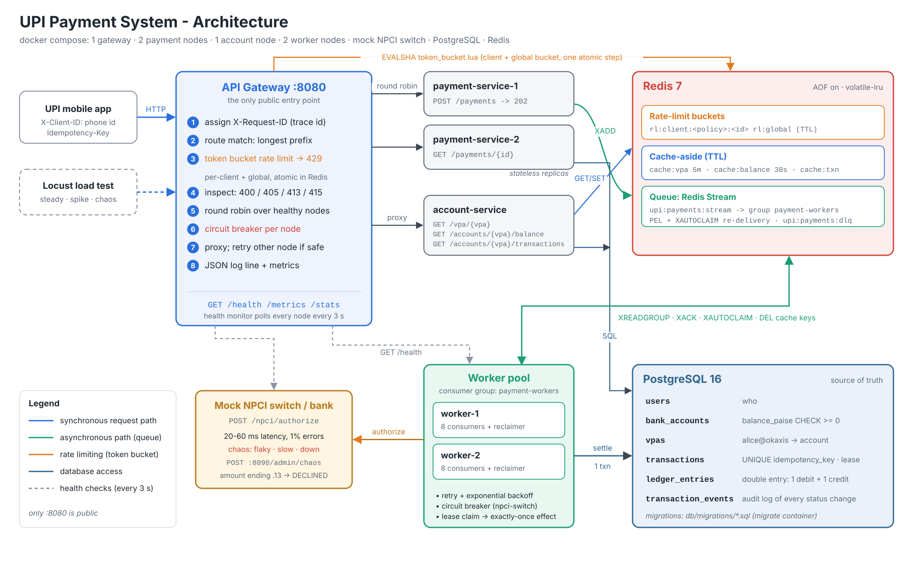
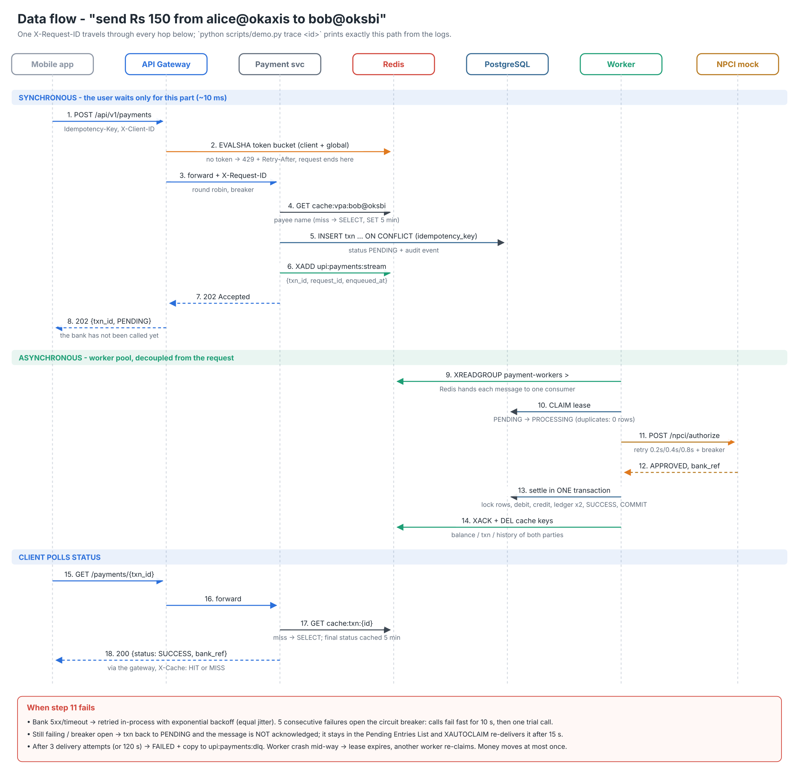
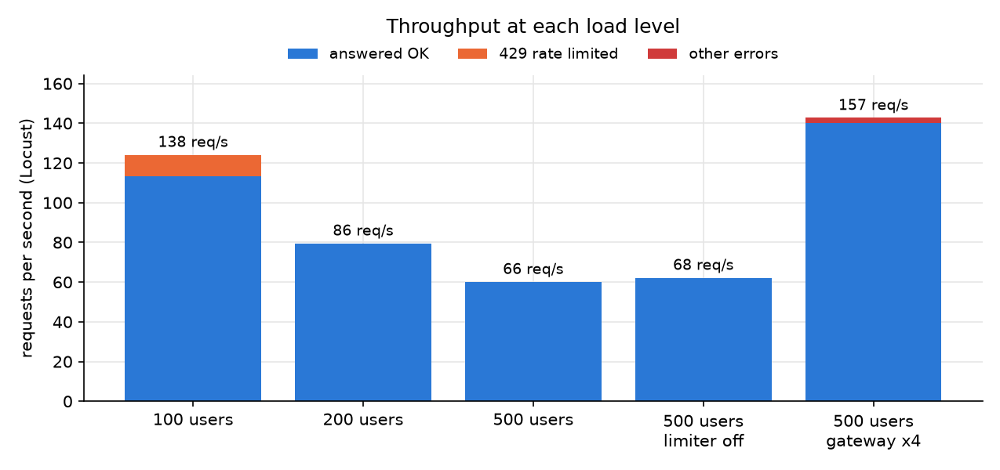
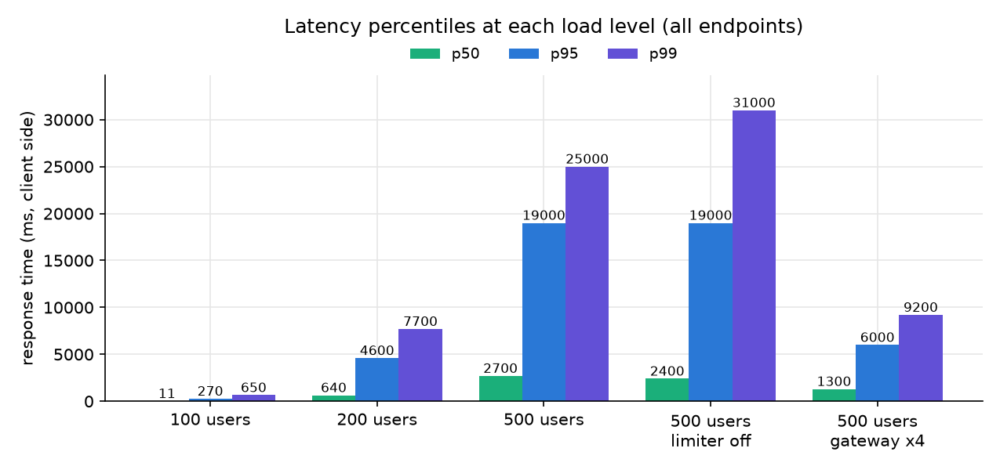
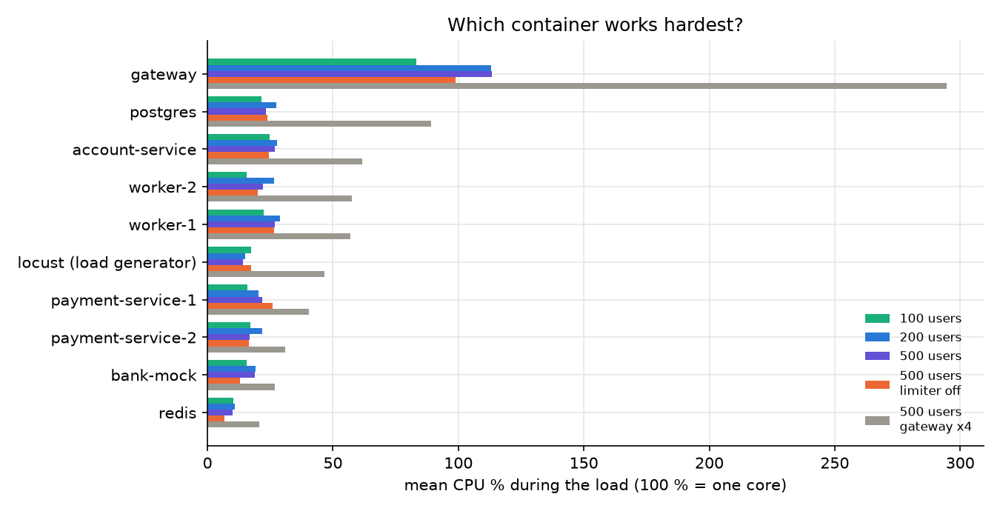
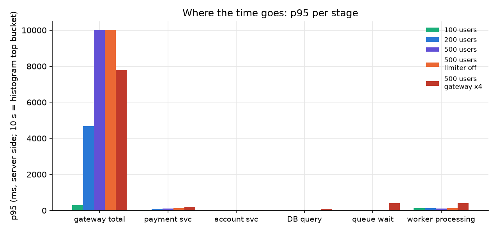
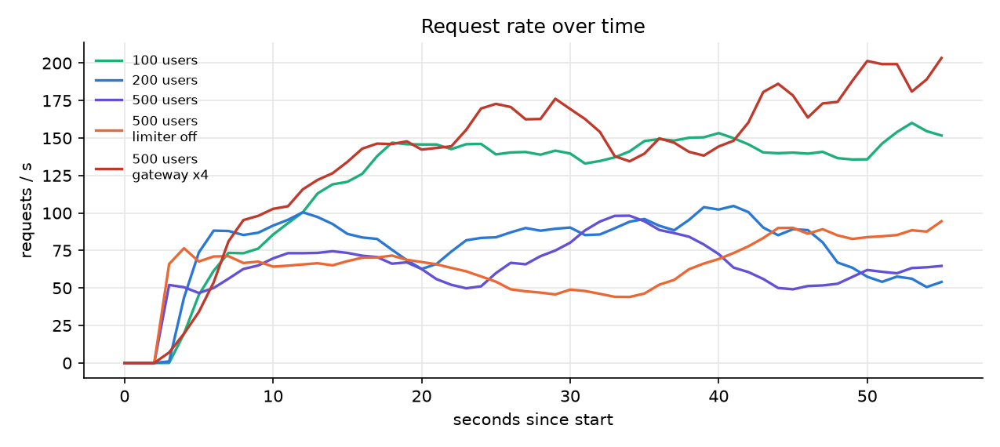
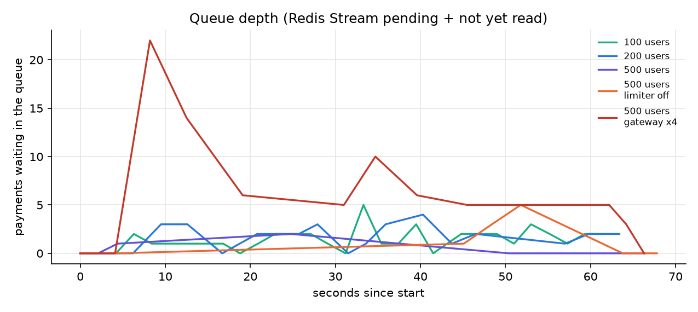

**GitHub repository: https://github.com/shrishtikarn/upi-system-design**

# UPI Payment System - Project and Load-Test Report

Distributed System Design - architecture, implementation of the three phases, load testing and bottleneck analysis

| | Name | Roll no. | GitHub |
|---|---|---|---|
| Member 1 | **Darsh Shah** | **26MCE001** | https://github.com/darsh-1010 |
| Member 2 | **Shrishti Karn** | **26MCE007** | https://github.com/shrishtikarn |


## 1. Summary

A containerised model of the backend behind a UPI payments app: an API gateway with token-bucket rate limiting and health-aware routing, stateless payment and account services, PostgreSQL as the source of truth, Redis for cache, rate-limit buckets and the payment queue, an asynchronous worker pool that talks to a mock NPCI switch, and circuit breakers + retries with exponential backoff. One `docker compose up` starts all 10 containers; every request can be traced through every hop from the structured logs.

- Load test at 100 / 200 / 500 users: peak **138 req/s** at 100 users with p95 270 ms; no 5xx errors and no lost payments at any level.
- **Bottleneck found: the single-process API gateway** (one CPU core, ~83-113% CPU) - at 500 users throughput fell to 66 req/s and p95 rose to 19.0 s, while the services, database and workers stayed fast.
- Running the gateway as 4 processes raised 500-user throughput to **157 req/s** and cut p50 latency from 2.7 s to 1.3 s.
- Functional test with 228 distinct users and 17 scenario types: 259/259 as expected, money conserved, every balance exact.

## 2. Requirements and where they are implemented

| Phase | Requirement | Implementation |
|---|---|---|
| 1 | Architecture diagram + data-flow sketch | `docs/architecture.png`, `docs/data-flow.png`, `docs/DESIGN.md` |
| 1 | `docker compose up` spins up gateway + nodes | `docker-compose.yml` (10 containers, one shared `Dockerfile`) |
| 1 | API gateway: inspect, route, rate limit -> 429 | `gateway/main.py` pipeline; `gateway/ratelimit.py` token bucket (Redis Lua, per client + global, local fallback) |
| 1 | Health endpoint per node | `GET /health` on the gateway polls every node's `/health` (`common/health.py`, `gateway/upstreams.py`) |
| 2 | Database + schema + migrations | PostgreSQL 16; `db/migrations/001-003*.sql`, runner `db/migrate.py`, `docs/DATABASE.md` |
| 2 | In-memory cache | Redis cache-aside (`common/cache.py`) for VPA, balance, history, payment status; rate-limit counters in Redis |
| 2 | Async queue + worker pool updating the DB | Redis Streams consumer group; `worker/main.py`, `worker/processor.py` (one DB transaction per settlement) |
| 3 | Resilience pattern | Circuit breaker + retry with exponential backoff and jitter (`common/resilience.py`), dead-letter stream, XAUTOCLAIM re-delivery, sweeper |
| 3 | Load-testing script | Locust `loadtest/locustfile.py`; `loadtest/run_loadtest.py`, `loadtest/scale_test.py` (100/200/500 users), `scripts/multi_user_test.py` |
| 3 | Metrics + structured logging, trace a request | JSON logs with request id (`common/logs.py`), metrics (`common/metrics.py`), `GET /stats`, `scripts/demo.py trace`, `/dashboard` |
| 3 | Load-test report | Section 6 of this report; `loadtest/scale_report.py`, `loadtest/make_report.py` |

## 3. Architecture and data flow


**Figure: Architecture: gateway, services, queue, workers, bank switch, PostgreSQL, Redis**


**Figure: Data flow of one payment through the system**

1. The app verifies the payee (`GET /api/v1/vpa/{vpa}`, cached) and sends `POST /api/v1/payments` with an `Idempotency-Key`.
2. The gateway assigns an `X-Request-ID`, takes a token from the user's bucket and the global bucket (else **429**), inspects the request (405/413/415/400) and proxies it round-robin to a healthy payment node whose circuit breaker is closed.
3. The payment service validates it (amount <= Rs 1 lakh, payer != payee, VPAs exist), stores it as **PENDING** (a duplicate key returns the original), appends it to the Redis Stream and answers **202** in milliseconds.
4. A worker claims it with a lease (**PROCESSING**), calls the bank switch through the circuit breaker with retries, then settles in **one PostgreSQL transaction** (row locks -> debit -> credit -> 2 ledger rows -> **SUCCESS** -> audit event), ACKs and invalidates the cache.
5. The app polls `GET /api/v1/payments/{id}` (cached) until SUCCESS / FAILED.

## 4. Implementation by phase

### Phase 1 - Gateway, rate limiting, health

- **Token bucket, two levels, atomic:** every request needs a token from its client's bucket (read: burst 40, 20/s; write: burst 10, 2/s) and from a global bucket (burst 500, 300/s). One Lua script checks and updates both in Redis using Redis' clock, so several gateway processes share one consistent limit; if Redis is down the gateway falls back to an in-process bucket.
- **Inspection and routing:** longest-prefix routes, 405/413/415, mandatory `Idempotency-Key` on payments, round robin over healthy nodes, one retry on another node when safe (GET or idempotent POST), per-node circuit breaker.
- **Health:** a background monitor probes every node's `/health` every 3 s; `GET /health` reports UP / DEGRADED / DOWN with per-node status, latency and breaker state.

### Phase 2 - Persistence, cache, asynchronous workers

- **Schema:** users, bank_accounts (balance in BIGINT paise, CHECK >= 0), vpas, transactions (unique idempotency key, status enum, lease columns, request id), ledger_entries (double entry), transaction_events (append-only audit).
- **Cache-aside** with TTLs (VPA 5 min, balance 30 s, history 15 s, status 1 s pending / 5 min final) and explicit invalidation by the worker; `X-Cache: HIT/MISS` on every read.
- **Queue:** Redis Streams consumer group shared by 2 worker containers x 8 consumers; at-least-once delivery + lease + conditional status updates = money moves exactly once.

### Phase 3 - Fault tolerance, load testing, observability

- **Retries** with exponential backoff and jitter (0.2 s, 0.4 s, 0.8 s) for bank 5xx/timeouts; **circuit breaker** opens after 5 consecutive failures for 10 s, then a half-open trial call; deferred payments are re-delivered by XAUTOCLAIM; after 3 deliveries -> FAILED + dead-letter stream.
- **Observability:** one JSON log line per event with service, node and request id; counters, gauges and latency histograms per node; `/stats`, `/metrics/prometheus`, live `/dashboard`.

## 5. Load test: 100, 200 and 500 concurrent users

**Tool:** Locust 2.43 (running in Docker on the same network as the gateway), script `loadtest/locustfile.py`, orchestrated by `loadtest/scale_test.py`. Each level runs for 60 s with a steady number of simulated phone users (each with its own device id) doing a realistic mix: check balance (8), verify payee (5), send money (4), poll payment status (3), history (1), with 0.5-1.5 s think time; plus 2 *abusive* clients hammering the balance API ~50 times/s from one device id. During every run `/stats` was sampled every 2 s and `docker stats` every ~3 s.

**Machine:** one laptop, 12 logical CPUs, Docker Desktop (WSL2), all 10 containers + Locust sharing it. Absolute numbers are therefore lower than on separate servers; the *trend* across load levels is what matters.

### Results

| Run | req/s | OK/s | 429s | Errors | p50 | p95 | p99 | Gateway p95 | Payments settled/s | Cache hit | Gateway CPU |
|---|---|---|---|---|---|---|---|---|---|---|---|
| 100 users | 138 | 113 | 697 | 0 | 11 ms | 270 ms | 650 ms | 294 ms | 15.4 | 73% | 83% |
| 200 users | 86 | 80 | 0 | 0 | 640 ms | 4.6 s | 7.7 s | 4.7 s | 15.1 | 76% | 113% |
| 500 users | 66 | 60 | 0 | 0 | 2.7 s | 19.0 s | 25.0 s | 10.0 s | 13.1 | 72% | 113% |
| 500 users, limiter off | 68 | 62 | 0 | 0 | 2.4 s | 19.0 s | 31.0 s | 10.0 s | 13.8 | 72% | 99% |
| 500 users, gateway x4 | 157 | 140 | 0 | 177 | 1.3 s | 6.0 s | 9.2 s | n/a | 29.5 | 66% | 294% |

req/s, OK/s, 429s, errors and p50/p95/p99 are measured by Locust (client side, all endpoints). Gateway p95 is the gateway's own latency histogram; payments settled/s, cache hit ratio and CPU come from `/stats` and `docker stats` (100 % CPU = one core).


**Figure: Throughput at each load level: requests answered OK (blue) and rejected with 429 (orange)**


**Figure: Client-side latency percentiles at each load level**

### How the rate limiter and the cache protected the system

- **Rate limiter:** at 100 users the two abusive clients were cut off by their per-client token bucket - **697 requests got 429 Too Many Requests** (client bucket: 697, global bucket: 0) at almost no cost (the 429 is decided before any service is called), while normal users saw no errors.
- **Cache:** 73-76% of balance / VPA / status reads were served from Redis, so PostgreSQL stayed fast at every level: DB query p95 was 5 ms at 100 users and 5 ms at 500 users.
- **Queue:** payments were accepted with 202 and absorbed by the Redis Stream; the queue never held more than 22 payments and the workers settled each one in about 67 ms (p50 end-to-end) even at 500 users.
- **No errors:** across all runs there were no 5xx responses or lost payments - the system degraded by getting slower, never by failing.

### Bottleneck analysis

> **Bottleneck: the API gateway process.** Going from 100 to 500 users, throughput did not rise - it **fell from 138 to 66 req/s**, and p95 latency grew from 270 ms to 19.0 s. The gateway container sat at **113-113% CPU - one full core** - while every other container stayed below ~30%.

Evidence that the time is lost *inside the gateway*, not in the services behind it:

| Stage (p95) | 100 users | 200 users | 500 users |
|---|---|---|---|
| Gateway total (gateway's view) | 294 ms | 4.7 s | 10.0 s |
| Account service upstream call (gateway's view) | 292 ms | 5.4 s | 10.0 s |
| Account service handler (service's own view) | 5 ms | 7 ms | 7 ms |
| Payment service handler | 37 ms | 82 ms | 110 ms |
| PostgreSQL query | 5 ms | 5 ms | 5 ms |
| Queue wait (stream -> worker) | 3 ms | 3 ms | 3 ms |
| Payment end-to-end (202 -> SUCCESS) | 99 ms | 100 ms | 98 ms |

- The account service answers in single-digit milliseconds at every level, yet the gateway waits seconds for the same calls: requests are queuing in the gateway's **single asyncio event loop**, which is CPU-bound. (Values shown as 10.0 s are the top bucket of the latency histogram, i.e. 10 s or more.)
- The gateway runs as **one uvicorn process**, so it can use only one CPU core however many the machine has. Per request it runs the rate-limit Lua script in Redis, proxies with `httpx`, records metrics and writes a JSON log line - roughly 6 ms of CPU per request at 100 users, which caps the whole system at about 138 req/s on this laptop.
- Back-end stages scale fine: DB queries, queue wait and worker settlement times are flat from 100 to 500 users.

**Rate limiter on vs off at 500 users:** 66 vs 68 req/s, p95 19.0 s vs 19.0 s - practically identical. The global token bucket (300 req/s) is set *above* what the gateway can actually process (~140 req/s here), so it never triggers; the per-client buckets also stop triggering at 200+ users because the saturated gateway slows the abusive clients down by itself. In other words, the limiter limits too late: it should be sized to the measured capacity.

### Experiment: scaling the gateway out

To confirm the diagnosis the same 500-user test was repeated with the gateway running **4 uvicorn processes** (`GATEWAY_WORKERS=4`; the rate-limit buckets live in Redis, so limits stay exact across processes). Throughput went from **66 to 157 req/s (2.4x)**, p50 latency from 2.7 s to 1.3 s and p95 from 19.0 s to 6.0 s, with 0 requests now (gateway CPU 294%, i.e. several cores) and payments settled 30/s instead of 13/s.

**The bottleneck moves on.** With the gateway no longer limiting, the next stages start to work hard: postgres 89%, account-service 62%, worker-2 58% CPU. 177 requests (1.9%) - all of them reads routed to the **single account-service replica** - got 503 Service Unavailable: when that one node answered too slowly the gateway's health check / per-node circuit breaker took it out of rotation for a moment, and with only one replica there was no other node to route to. (A 30-s repeat at the same load did not reproduce the 503s, so this is intermittent.) The payment service, which already has two replicas, had no errors.


**Figure: Mean CPU per container during each run (100 % = one core): the gateway is the only container near or above one core**


**Figure: Server-side p95 per stage: only the gateway grows with load**


**Figure: Request rate over time in each run**


**Figure: Payment queue depth over time: the workers keep up at every level**

### Recommendations

1. **Scale the gateway horizontally**: several processes (`GATEWAY_WORKERS`) or several gateway containers behind a TCP load balancer. It is stateless apart from Redis, so this is safe; move health checks and metrics aggregation to a shared store so `/stats` stays complete with many processes.
2. **Run a second account-service replica** (as the payment service already does) and add PostgreSQL read capacity (connection pooling via PgBouncer, a read replica for balance/history) - these are the next stages to saturate once the gateway is scaled.
3. **Size the global token bucket to measured capacity** (about 80 % of the throughput at which latency starts to climb), so excess load is shed with cheap 429s *before* the event loop saturates - that keeps latency low for admitted users.
4. **Make each proxied request cheaper**: reuse one HTTP/1.1 keep-alive pool per upstream (already done) and consider a faster client (e.g. aiohttp), sample per-request log lines at high load, and batch metrics.
5. **Add an end-to-end deadline** at the gateway (e.g. 2 s) so a request that has already waited too long in the queue is rejected quickly instead of occupying the loop.

## 6. Functional test with 100+ users (all scenarios)

`scripts/multi_user_test.py` drove 228 distinct users through every scenario a real UPI app meets; each user had its own device id. Results:

| Scenario | Requests | As expected | Outcomes |
|---|---|---|---|
| P2P transfer | 100 | 100/100 | SUCCESS x100 |
| P2M merchant payment | 30 | 30/30 | SUCCESS x30 |
| Concurrent payments to one payee | 20 | 20/20 | SUCCESS x20 |
| Concurrent overspend | 3 | 3/3 | SUCCESS x2, FAILED x1 |
| Double tap (idempotent replay) | 10 | 10/10 | SUCCESS x10 |
| Idempotency key reused | 5 | 5/5 | SUCCESS x5 |
| Bank decline | 10 | 10/10 | FAILED x10 |
| Insufficient funds | 1 | 1/1 | FAILED x1 |
| Amount above Rs 1 lakh | 4 | 4/4 | HTTP 422 AMOUNT_LIMIT_EXCEEDED x4 |
| Pay yourself | 4 | 4/4 | HTTP 422 SAME_PAYER_PAYEE x4 |
| Unknown payee | 4 | 4/4 | HTTP 404 PAYEE_VPA_NOT_FOUND x4 |
| Malformed VPA | 4 | 4/4 | HTTP 422 VALIDATION_ERROR x4 |
| Missing Idempotency-Key | 4 | 4/4 | HTTP 400 MISSING_IDEMPOTENCY_KEY x4 |
| Rate limit (one user floods 30 requests) | 30 | 30/30 | HTTP 202 x10, HTTP 429 x20 |
| Bank flaky (50% errors) | 20 | 20/20 | SUCCESS x20 |
| Bank down, then recovers | 10 | 10/10 | SUCCESS x10 |

| Consistency check | Result |
|---|---|
| Total money in the system unchanged | PASS |
| Every one of 233 tracked accounts moved by exactly its SUCCESS payments | PASS |
| No negative balances | PASS |
| No payment left PENDING/PROCESSING | PASS |
| Every double tap returned the original transaction (one debit) | PASS |

## 7. How to run

```
git clone https://github.com/shrishtikarn/upi-system-design.git && cd upi-system-design
docker compose up --build -d
python scripts/smoke_test.py                      # 11 end-to-end checks
open http://127.0.0.1:8080/dashboard and http://127.0.0.1:8080/pay
python scripts/multi_user_test.py                 # 100+ users, every scenario
python loadtest/scale_test.py --gateway-workers 4 # 100/200/500-user load tests
python loadtest/scale_report.py                   # numbers + charts
```

## 8. References

1. NPCI - Harmonisation of TAT and customer compensation for failed transactions (IMPS/UPI OC 93, 2019) - https://www.npci.org.in/PDF/npci/imps/circular/2019/IMPS-UPI-I-OC-93-I-FY-19-20-I-Harmonisation-of-Turn-Around-Time(TAT)-and-customer-compensation-for-failed-transaction.pdf
2. NPCI - UPI Circular 17: Debit reversals and deemed approval - https://www.npci.org.in/PDF/npci/upi/circular/2017/Circular-17-Debit-Reversals-and-Deemed-Approval_0.pdf
3. NPCI - UPI OC 45: Solutions to reduce deemed approved transactions - https://www.npci.org.in/PDF/npci/upi/circular/2018/UPI OC 45 - Solutions to reduce deemed approved transaction.pdf
4. NPCI - OC 149-A: Reduction of business declines in UPI - https://www.npci.org.in/PDF/npci/upi/circular/2022/OC149-A-Addendum-to-OC-149-Reduction-of-business-declines-in-UPI.pdf
5. Oracle - India Unified Payments Interface (UPI) switch documentation - https://docs.oracle.com/cd/G15796_01/RHTML/India_UPI/Responsive%20HTML5/UPI/UPI/UPI.htm
6. Business Today - NPCI to increase UPI limits for high-value payments from Sept 15 (2025) - https://www.businesstoday.in/personal-finance/banking/story/npci-to-increase-upi-transaction-limits-for-high-value-payments-from-sept-15-check-updated-limits-493278-2025-09-09
7. Paytm Blog - UPI limits get a big boost from 15 Sept (2025) - https://paytm.com/blog/news/upi-higher-transaction-limits-sep-2025
8. Razorpay Blog - UPI transaction limit per day - https://razorpay.com/blog/upi-transaction-limit-per-day/
9. Business Standard - NPCI tightens UPI API supervision to curb network stress (2025) - https://www.business-standard.com/finance/news/npci-tightens-upi-api-supervision-to-curb-network-stress-125052201406_1.html
10. Digit - NPCI's new UPI API rules from August 1 (balance-check limits) - https://www.digit.in/news/general/upi-alert-npcis-new-rules-kick-in-from-august-1-heres-what-changes.html
11. Legal500 - NPCI guidelines on UPI and API usage - https://www.legal500.com/intelligence/india/technology/npci-guidelines-on-upi-and-api-usage
12. Zerodha Support - Failed UPI transaction error codes - https://support.zerodha.com/category/funds/adding-funds/articles/failed-upi-transaction
13. PhonePe Developer - Payment gateway error codes - https://developer.phonepe.com/payment-gateway/error-codes
14. Paytm Blog - What is error code U30 in UPI? - https://paytm.com/blog/payments/upi/what-is-error-code-u30-in-upi/
15. Paytm Blog - Bank responsibility for failed UPI transactions - https://paytm.com/blog/payments/upi/bank-responsibility-for-failed-upi-transaction
16. Razorpay Blog - Deemed success in IMPS/UPI payouts - https://razorpay.com/blog/payout-processing-imps-upi-transactions-deemed-success-npci/
